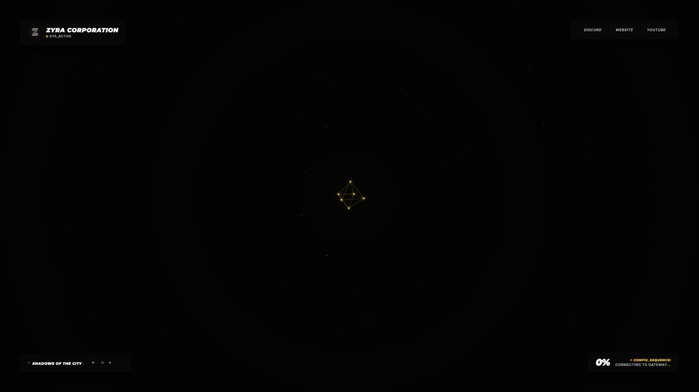
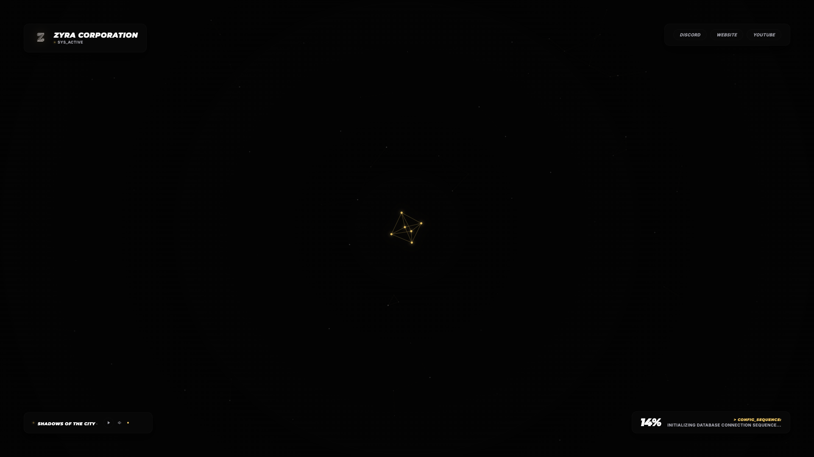

<p align="center">
  
  
  
</p>

# 🌌 Zyra Loading Screen 7 - Constellation HUD Edition

Welcome to **Zyra-Loading-Screen-7**, a sci-fi constellation loading screen resource by **Zyra Store**. Features a constellation starfield particle network connected by glowing neon lines and holographic HUD overlays.

---

## 📸 Preview Showcase





---

## 🛠️ Key Features

- **Constellation Canvas Backdrop:** Interactive HTML5 particle starfield interconnected by glowing neon nodes.
- **Holographic HUD Overlays:** Futuristic cyber grid lines, corner brackets, and glowing neon status indicators.
- **Live Audio Streaming:** Music playback controller with visual audio stream indicators.
- **Real-Time Download Tracking:** Animated glowing progress bar tracking FiveM asset downloads.

---

## 📦 Installation Instructions

1. **Copy the Resource:**
   Copy `Zyra-Loading-Screen-7` into your server's `resources` directory:
   `resources/[zyra]/Zyra-Loading-Screen-7`

2. **Configure `server.cfg`:**
   Add to your `server.cfg`:
   ```cfg
   ensure Zyra-Loading-Screen-7
   ```

3. **Restart Server:**
   Save `server.cfg` and restart the server or execute:
   ```cmd
   refresh
   ensure Zyra-Loading-Screen-7
   ```

---

## ⚙️ Configuration Guide (`config.js`)

- **Hologram Titles:** Edit server name and holographic welcome text.
- **Particle Dynamics:** Adjust particle density and connection color parameters if desired.
- **Audio Tracks:** Add `.mp3` links and set volume level.

---

## ⛔ License & Commercial Restrictions

> [!CAUTION]
> **RESALE IS STRICTLY PROHIBITED (OPEN CODE RESOURCE)**
> This resource is released as **Open Code / Open Source**. Selling, re-selling, monetizing, or offering this resource on Tebex, Discord, or any commercial platform is **STRICTLY PROHIBITED**. You are permitted to modify and use this code freely on your personal FiveM servers, but commercial distribution is prohibited by **Zyra Store**.

---

## 💎 Credits & Support

Developed with ❤️ by **Zyra Store**.  
All rights reserved.
